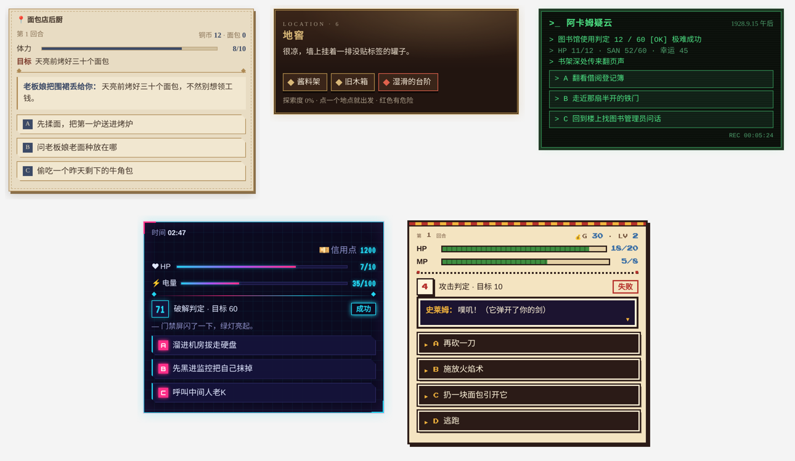

# 游戏卡片 · Game UI Cards

用 ChatGPT 或 Claude 跑文字游戏时，在聊天里显示稳定、好看的游戏卡片：数值条、背包、地点、人物、掷骰判定，还有可以直接点的选项按钮。

## 它是什么

一个「显示层」。它不带任何游戏规则，也不写剧情。规则和故事都由 AI 负责，AI 每回合把当前状态（比如血量、金币、背包、选项）交给它，它负责画成卡片。

AI 只交数据，长什么样由代码决定，所以每回合的卡片风格稳定，不会这回一个样、下回又一个样。

- **五套皮肤**：纸面档案、剧场报幕、异常终端、霓虹街区（赛博朋克）、像素冒险海报（8-bit）。按游戏题材自动选，也可以点名指定。
- **六种卡片**：选择卡、状态卡、背包卡、地点卡、地图卡、人物卡。每回合自动挑最合适的一张，有选项就出选择卡。
- **自动标变化**：金币 +2、体力 -1、获得新道具、来到新地点，都会自动高亮。
- **点选项就能玩**：点卡片上的选项，那句行动会直接作为你的消息发出去。
- **内置字体和音效**：像素字体、霓虹字体，点击、掷骰、成功、失败等音效都由代码合成，不加载外部文件，国内网络也能正常显示。

## 哪里能用

| 平台 | 情况 |
|---|---|
| ChatGPT | 实测可用。要在网页版设置里打开开发者模式后添加连接器；加好以后手机 App 里也能显示卡片。据官方资料，开发者模式需要付费账号（Plus / Pro / Business 等），免费账号不行。 |
| Claude | 实测可用。在设置里添加自定义连接器即可，免费账号也能加（免费账号只能加一个自定义连接器）。 |
| 其他软件 | 只要支持 MCP Apps 标准（例如 VS Code、Goose），理论上也能用，没有实测。 |
| 豆包、Kimi、DeepSeek 网页版、Gemini App 等 | 目前不能添加自定义连接器，用不了。 |

各家规则会变，以官方说明为准。

## 怎么用

### 第一步：添加连接器

连接器地址：**`（发布后填写公开地址）/mcp`**

**ChatGPT（网页版操作，手机浏览器打开 chatgpt.com 也行）：**

1. 点左下角头像 → Settings（设置）。
2. 进入 Apps（应用）→ Advanced settings（高级设置），打开 Developer mode（开发者模式）。
3. 回到 Apps，点 Create（创建）。
4. Name（名字）随便填，比如「游戏卡片」；MCP Server URL（服务器地址）粘贴上面的连接器地址。
5. Authentication（认证）选 No authentication（无需认证），勾选同意，点 Create（创建）。

**Claude：**

1. 打开 Settings（设置）→ Connectors（连接器）。
2. 点 Add custom connector（添加自定义连接器）。
3. Name（名字）随便填，URL（地址）粘贴上面的连接器地址，点 Add（添加）。

### 第二步：开新聊天，发一句话

ChatGPT 新开聊天时，记得在输入框的「+」号里把这个连接器选上。

复制下面任意一句发给 AI 就能开玩：

- 用游戏卡片陪我玩一局赛博朋克黑客冒险，我是刚入行的新手。
- 用游戏卡片跑一局 8bit 像素风的地下城，我是拿着木剑的勇者。
- 用游戏卡片陪我玩一局面包店经营，我是凌晨四点刚上班的学徒。
- 用游戏卡片跑一局克苏鲁调查，1920 年代，我是图书馆员。
- 用游戏卡片陪我玩一局宫廷戏剧，我是新来的宫廷乐师。

想换风格就直接说，比如「换成像素风皮肤」「换成霓虹街区皮肤」。想看背包、人物或地点，就说「看看我的背包」。

## 常见问题

**卡片不显示，只有一串文字？**
先确认用的是 ChatGPT 或 Claude，并且这次聊天选上了连接器。还不行的话，把连接器删掉重新添加一次，因为软件会缓存旧版卡片。

**手机上没有音效？**
iPhone 要关掉侧面的静音键；安卓要把媒体音量调大。另外每张卡都要先点一下才会出声，这是手机浏览器的规定。

**中文字体跟截图不太一样？**
中文用的是手机自带字体，iPhone 和安卓会略有差别，这是正常的。特色字体只覆盖英文和数字。

**AI 忘了用卡片？**
跟它说一句「记得每回合都用游戏卡片显示」。

**会保存我的游戏吗？**
不会保存剧情。服务器只记一份上一回合的状态，用来标出「本回合变化」，30 天不用自动删除。游戏进度靠的是聊天记录本身。

## 自己部署一份（可选）

不想用公开地址，或者想自己改，可以免费部署到 Cloudflare，全程在网页上操作。

1. 下载上传包 [download/game-ui-cards-v0.8.0.zip](download/game-ui-cards-v0.8.0.zip)（点进去后点右边的下载按钮），**不用解压**。
2. 登录 [Cloudflare](https://dash.cloudflare.com)，左边菜单进 Storage & Databases（存储和数据库）→ D1，点 Create database（创建数据库），名字随便填，比如 `game-ui`。
3. 左边菜单进 Workers & Pages → Create（创建）→ 选 Pages → Upload assets（上传文件），项目名随便填，把 zip 拖进去，点 Deploy（部署）。
4. 进入这个项目的 Settings（设置）：
   - Bindings（绑定）→ Add（添加）→ D1 database：Variable name（变量名）填 `PROBE_DB`，选第 2 步建的数据库，保存。
   - Variables and Secrets（变量和密钥）→ Add（添加）：名字填 `PUBLIC_MODE`，值填 `1`，保存。
5. 回到 Deployments（部署）页，点 Create deployment（新建部署），把同一个 zip 再上传一次，让上面的设置生效。
6. 你的连接器地址就是 `https://你的项目名.pages.dev/mcp`。浏览器打开 `https://你的项目名.pages.dev/health`，能看到 `"ok":true` 就说明成功了。

只想自己用、不想让别人连的话，第 4 步不填 `PUBLIC_MODE`，改填 `PROBE_MCP_PATH`，值为 `/probe-` 加 64 位随机十六进制字符再加 `/mcp`，把这个当作私人地址。

## 给 AI 和开发者看的

- 工具：`render_game_ui`（主要）、`show_game_view`（把外部游戏引擎返回的画面转成卡片）。
- 状态用中文字段名，常见写法见工具说明。数值支持 `7`、`"7/10"`、`"40%"`，字段名前可以加表情当图标。
- 可选的 `fields` 参数用来声明字段类型、范围、枚举和锁定；`skin` 参数用来指定皮肤；公开部署下新游戏会发一个 `game_id`，之后每次调用带上。
- 本地开发：`npm test` 跑测试，`npm run dev` 生成 `dist/preview/` 预览页，`npm run release` 打包。

## 授权与致谢

本项目仅限非商业使用（PolyForm Noncommercial 1.0.0）：可以免费部署、修改、分享，不能拿去商用。借鉴的项目、字体作者和完整说明见 [CREDITS.md](CREDITS.md)。
